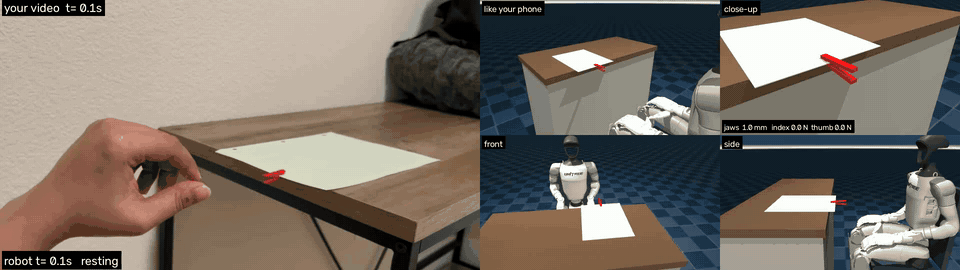
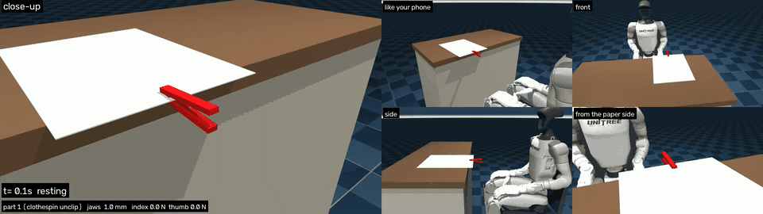
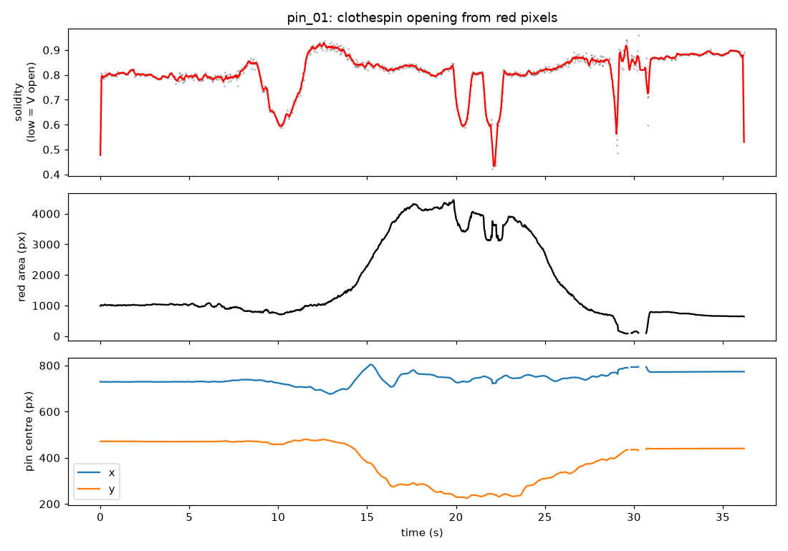

# Teach a Humanoid With Your Own Hands: clothespin

A seated Unitree G1 humanoid with a five-finger **Inspire hand (DFQ)** works a spring clothespin clipped on the
edge of a sheet of paper, in **MuJoCo**, following a phone video of me doing it with my left hand.

Two tasks:
1. **Unclip, open/close, put down:** unclip the pin, hold it, lift it, open and close it in the air at the times
   I did in my video, then put it back down on the paper.
2. **Unclip, hold, clip it back:** unclip the pin, hold it, then clip it back onto the paper edge and let go.

Follow-up to the [cup pick and place](https://github.com/pooja-tiwari12/g1-cup-pick-and-place) project, based on
the Armature AI Labs *Teach a Humanoid With Your Own Hands* challenge.

## 1. Unclip, open/close in the air, put down



**Full video:** [videos/pin_01_full_task.mp4](videos/pin_01_full_task.mp4). Left: my phone video, lined up step
by step with the robot. Right: four robot views, with the jaw opening and both finger forces.

## 2. Unclip, hold, clip it back



**Full video:** [videos/reclip.mp4](videos/reclip.mp4). Left: close-up of the pin. Right: four views.

## Results

| task | result |
|---|---|
| unclip | jaws opened 4.4 mm (index 3.0 N, thumb 3.0 N); pin slid off the paper and stayed in the hand |
| grip on the tail tips | index 25 mm, thumb 30 mm from the spring, jaws shut, ~1.6 N each finger |
| lift | 79 mm, still held |
| open/close in the air, at my video's times (20.0–20.8 s and 21.6–22.6 s) | 6.3 mm open both times, shut in between, never dropped |
| put down | resting flat on the paper, fingers off → `FULL TASK: PASS` |
| clip it back | jaws clamped at 1.0 mm on the 1 mm paper, 15.6 mm onto it, flat, hand off → `CLIPPED BACK: PASS` |

## How it works

**From my video** ([`clothespin/scripts/measure_pin_opening.py`](clothespin/scripts/measure_pin_opening.py)):
when the pin was open, shut and lifted, measured from the red pixels of the painted pin (the shape of the red
blob tells open from shut). The robot follows that timing.



**Unclip by moments.** The spring resists with a torque about its hinge. A finger pressing a tail with force F at
distance d from the spring makes a moment F·d, and to open the pin, F·d must beat the spring
([`spring_moment.py`](clothespin/scripts/spring_moment.py)):

| finger presses at | force per finger to hold the jaws 4 mm open |
|---|---|
| 10 mm from the spring | 7.0 N |
| 20 mm | 3.5 N |
| 30 mm (tail tip) | 2.3 N |

The press sets **how hard** from that rule, and **the ratio** between thumb and index so the moments about the
paper clamp cancel. While the pin is clipped, it can only pivot about the paper, so this stops it turning.

**The sequence** ([`unclip_press.py`](clothespin/scripts/unclip_press.py)):
1. Thumb up until it touches the bottom leg, then index down until it touches the top leg.
2. Wait until the pin is still, then press.
3. Slide it off the paper, holding the jaws 6 mm open, and close them gently once off.
4. Grip the tail tips, lift, open and close in the air, put it down, let go.

**Clip it back** ([`reclip.py`](clothespin_reclip/scripts/reclip.py)):
1. Open the jaws to 5 mm and line the gap up with the paper edge, with feedback every 20 ms because the arm lags
   its target by a few mm.
2. Slide 15 mm onto the paper, then close slowly; the fingers freeze once the jaws touch the paper.
3. Let go in order: index up, hand down, then the thumb.

## What worked and what didn't
- ❌ **My real mini clothespin (3.5 cm, 13 mm tails) was too small** for the robot's ~15 mm fingertips. As the
  index curls its tip sweeps along the pin, and the pin scissored out between the fingers in 1000+ physics runs.
  ✅ Switched to a **standard clothespin (72 mm, 30 mm tails)**. Its size is a typical estimate, not measured.
- ❌ **The pin's hinge was secretly held by a motor:** a helper from the cup project adds a motor to every joint
  and caught the pin's hinge too, so no squeeze could ever open it. ✅ Found by testing the pin alone
  ([`pin_alone_test.py`](clothespin/scripts/pin_alone_test.py)). Lesson: test the object model by itself first.
- ❌ **Index-only press tipped the whole pin** instead of squeezing it. ❌ Equal forces still turned it (fingers
  at different distances). ✅ **Moments**: the spring rule above, balanced about the paper clamp.
- ❌ **The pin crept through the fingers at ~5 mm/s** even with the fingers still: MuJoCo's friction is slightly
  soft. ✅ MuJoCo's no-slip solver (`noslip_iterations`).
- ❌ **Any steady squeeze snapped the pin fully open**: the spring is preloaded, so its torque hardly grows as it
  opens. ✅ Control the opening itself: moment = spring torque at the *wanted* opening ÷ finger distance.
- ✅ **Fingers on the tail tips, just inside the end:** the longest lever, so the least force. On the corner the
  thumb slipped off.
- ✅ **6 mm is the widest steady opening:** at 3–6 mm the fingers move ~3 mm and the pin tilts under 10°; from
  7 mm it wobbles, and from 9 mm it's dropped.
- ❌ **Flat fingertip pads** (more contact area): 1 of 36 placements passed vs 3 of 36 without, and the opening
  stopped at 7 mm. A real rubber pad bends to fit; MuJoCo's rigid plate can't. Kept as an option, off.
- ⚠️ **Fragile:** only a few hand placements pass the full task, and small changes to the hand angle matter.

## Run it
```bash
python3 -m venv .venv && source .venv/bin/activate
pip install -r requirements.txt

python sim/build_scene.py                              # robot model -> sim/g1_inspire_scene.xml
python clothespin/sim/build_pin_scene.py               # cabinet, paper, clipped pin -> clothespin/sim/pin_scene.xml
python clothespin/scripts/pin_alone_test.py            # the pin by itself: stays clipped, opens, snaps back
python clothespin/scripts/unclip_press.py --full       # task 1, prints each step + PASS/FAIL
python clothespin_reclip/scripts/reclip.py             # task 2, prints each step + PASS/FAIL

mjpython clothespin/scripts/unclip_press.py --full --viewer --slow 4    # watch task 1 (Mac: mjpython)
mjpython clothespin_reclip/scripts/reclip.py --viewer --slow 3          # watch task 2
python clothespin_reclip/scripts/make_video.py                          # remake the task 2 video
```
- `clothespin/scripts/make_video.py` (task 1 video) and `measure_pin_opening.py` read my phone recording, which
  isn't in this repo. Put your own as `clothespin/data/raw_videos/pin_01.mp4`; without it the video's left panel
  stays black.
- The pin's size is in [`clothespin/data/clothespin.yaml`](clothespin/data/clothespin.yaml). `use:` switches
  between my mini pin and the standard pin.

## Repository
```
sim/                 robot model (Unitree G1 + Inspire DFQ hand) and its builders, shared with the cup project
data/objects.yaml    used by the robot builder (motors, ready pose)
clothespin/          task 1: pin model, scene, unclip + open/close + put down, searches, tests, video
clothespin_reclip/   task 2: unclip, hold, clip it back, video
videos/              the final videos (mp4) and their previews (gif)
```
More detail: [`clothespin/README.md`](clothespin/README.md), [`clothespin_reclip/README.md`](clothespin_reclip/README.md).

## Licenses and credits
- Robot model: Unitree G1 + Inspire hand from [unitree_ros](https://github.com/unitreerobotics/unitree_ros),
  BSD 3-Clause ([`sim/assets/g1_inspire/LICENSE_unitree_ros`](sim/assets/g1_inspire/LICENSE_unitree_ros)).
- Simulation: [MuJoCo](https://mujoco.org).
